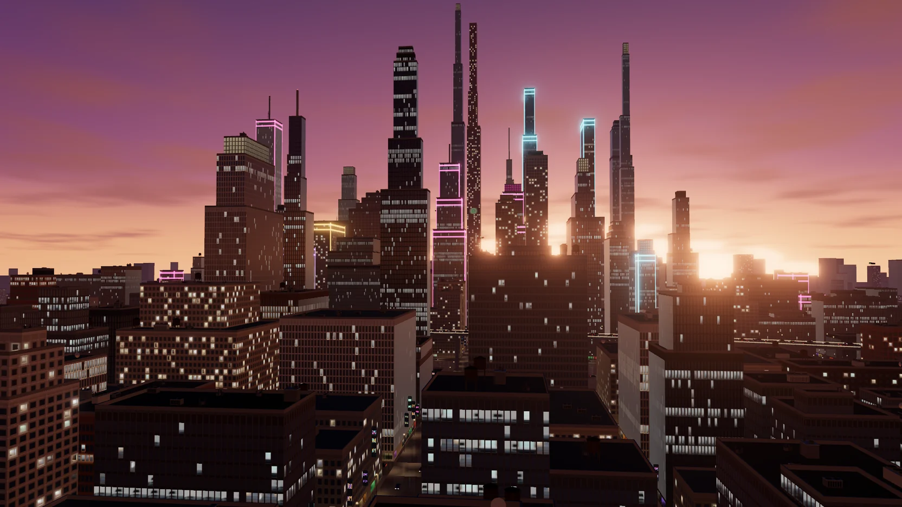
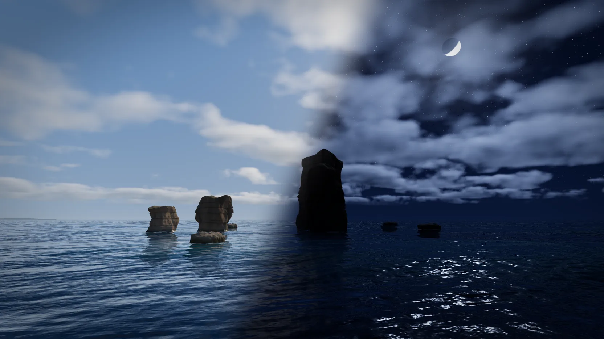
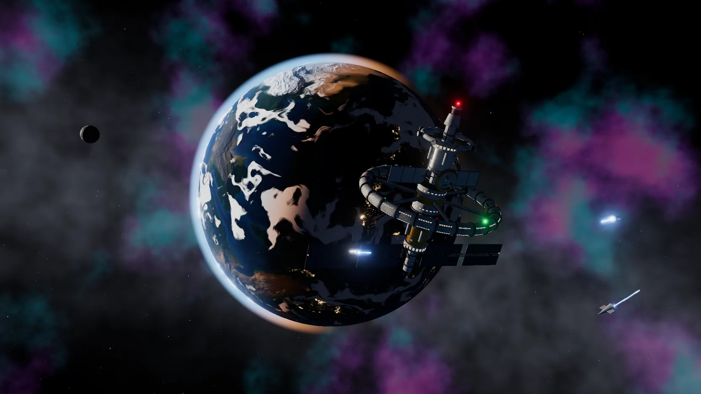

# Wall3D

> 三幕实时 3D 桌面壁纸 —— 霓虹都市、海天日月、星港轨道，在浏览器里直接预览。

[](LICENSE)
[](https://vercel.com/new)

<!-- 预览图占位：将落地页首屏截图保存为 assets/preview.png 即可显示 -->


**在线演示**：<https://wall3d.vercel.app>

## 简介

Wall3D 是一个基于 [KPanel 场景包](https://github.com/kejilion/KPanel)运行时、使用 [three.js](https://threejs.org) 实时渲染的桌面 3D 壁纸展示项目。每个场景都是一段可无限循环的动态画面，支持多机位平滑切换、昼夜轮转，可直接嵌入浏览器预览或作为动态壁纸持续运行。

落地页为纯静态单页，无构建依赖；禁 JavaScript 或 WebGL 不可用时自动回退为静态海报。兼容 GitHub Pages、Vercel 等任意静态托管。

## 特性

- **实时渲染**：three.js 驱动，机位平滑飞行切换，昼夜轮转（海天日月十分钟一轮）
- **多机位**：每个场景 2–4 个机位（全景 / 近景 / 特写），一键切换
- **渐进增强**：海报为默认内容，实时预览为增强；WebGL 失败自动降级
- **性能友好**：懒加载、离屏暂停、页面隐藏全暂停、空闲预载
- **零构建部署**：纯 HTML / CSS / JS，静态托管一键上线

## 目录结构

```
Wall3D/
├── index.html            落地页入口（单页展示 + 实时预览 + 机位切换）
├── assets/
│   ├── landing.css       页面样式
│   └── landing.js        交互逻辑（场景切换 / 懒加载 / 滚动动效）
├── vendor/               本地第三方库（GSAP / ScrollTrigger / Lenis，离线可用）
├── objects/              场景包（每个场景一个独立目录）
│   ├── 3c2d1025…/        霓虹都市 Neon City
│   ├── 73fc4349…/        海天日月 Sea and Sky
│   └── ff18942f…/        星港轨道 Orbital Station
├── vercel.json           Vercel 部署配置
├── .gitignore
└── _task/                开发产物（交付说明 / 取证截图，不入库、不部署）
```

单个场景目录：

```
objects/<scene-id>/
├── manifest.json         场景元数据（名称 / 描述 / 机位 / 主题色 / 许可）
├── index.html            场景入口
├── scene.js              自包含 three.js 场景（打包后）
├── poster.webp           海报（16:9 静态预览）
├── thumb.webp            缩略图
├── assets/               模型 / 纹理 / draco 等资源
└── license.txt           许可声明
```

## 场景介绍

### 01 霓虹都市 · Neon City

从黄昏到雨夜，高架车流与霓虹招牌点亮整座不夜城。

| 机位 | 说明 |
| --- | --- |
| 黄昏天际线 | 全景，城市天际线剪影 |
| 蓝调高架 | 中景，蓝调时刻的高架车流 |
| 雨夜街巷 | 近景，雨夜街巷与霓虹招牌 |



主题色：`#c2357f`（品牌）/ `#2ec4d6`（强调）

### 02 海天日月 · Sea and Sky

礁石、海天与远岸城市：日月星辰十分钟轮转一个昼夜。

| 机位 | 说明 |
| --- | --- |
| 日月光带 | 日月与光带 |
| 礁石剪影 | 礁石剪影前景 |
| 海天一色 | 海天相接全景 |
| 远岸城市 | 远岸城市天际线 |



主题色：`#2f7fb5`（品牌）/ `#f2a25c`（强调）

### 03 星港轨道 · Orbital Station

从星云深处缓缓靠近行星，环形空间站在轨道上徐徐旋转。

| 机位 | 说明 |
| --- | --- |
| 行星全景 | 行星与星云全景 |
| 空间站近景 | 环形空间站近景 |
| 行星日出 | 行星边缘日出 |



主题色：`#2f6fd0`（品牌）/ `#35b8d6`（强调）

## 场景制作规范

新增场景时遵循以下规范，确保与现有场景风格统一、可作为桌面壁纸长时间运行。

### 构图

- 统一 16:9 桌面壁纸比例，主体置于黄金分割点附近，四周预留约 5–8% 安全边距，避免被任务栏、桌面图标遮挡。
- 单个场景只保留一个视觉主角，其余元素安静陪衬；前景剪影可增加层次，但不得遮挡主体。

### 相机机位

- 每个场景提供 2–4 个机位，在 `manifest.json` 的 `cameras` 中声明（含中英文名）。
- 机位核心字段：`position`（位置）、`target`（注视点）、`fov`（视场角）、`orbit`（自动环绕幅度）、`float`（浮动幅度）、`tod`（昼夜时段索引）。
- 默认视场角约 45°，超广角仅用于近景张力；机位之间为平滑飞行过渡，禁用硬切。
- 场景支持空闲自动轮换机位，手动切换后重新计时。

### 模型比例

- 统一真实世界尺度（单位米），据此设定相机近平面 / 远平面，避免比例失真与巨物压迫感。
- 主体比例符合物理常识，关键物件（建筑、礁石、空间站）之间的相对尺度一致。

### 光照

- 每个场景有明确的时段基调，通过环境光 + 主光方向 + 主题色统一。
- 示例：霓虹都市「黄昏 → 雨夜」，海天日月「十分钟昼夜轮转」，星港轨道「行星日出」。
- 发光材质（霓虹、星云、窗口）适度配合后处理光晕，避免大面积过曝。

### 桌面壁纸适配规则

- 渲染输出 16:9，设备像素比上限 1.5，适配高 DPI 显示器。
- 主体不贴边、无纯黑死区，作为壁纸长时间停留不刺眼。
- 场景可无限循环、持续运行，动效幅度克制（缓慢漂浮 / 环绕），不制造视觉疲劳。

### 渲染质感

- 采用 ACES 色调映射（`toneMappingExposure = 1`），sRGB 输出色彩空间。
- 后处理统一走 bloom 光晕，控制高光范围与强度。
- 材质使用 PBR（金属度 / 粗糙度 / 法线贴图），模型与纹理保持真实质感。

### 景深要求

- 主视场角 45°，远平面 14000，保证远景不裁切。
- 画面明确分出前、中、远三层：前景（剪影 / 近景物件）、中景（主体）、远景（天空 / 背景 / 城市轮廓）。
- 前景可用剪影或浅景深营造层次，但不遮挡主体。

## 部署指南

### 一、推送到 GitHub

```bash
# 1. 在项目根目录初始化仓库（已初始化可跳过）
cd Wall3D
git init

# 2. 添加并提交（.gitignore 已排除 _task/ 等开发产物）
git add .
git commit -m "init: Wall3D 桌面 3D 壁纸项目"

# 3. 关联远程仓库并推送
git branch -M main
git remote add origin https://github.com/meimolihan/Wall3D.git
git push -u origin main
```

> 已配置 SSH 的用户可将远程地址替换为 `git@github.com:meimolihan/Wall3D.git`。

### 二、Vercel 一键部署

本项目为纯静态站点，无构建步骤，Vercel 导入即可上线。

**方式 A：Vercel 面板（推荐）**

1. 访问 [vercel.com/new](https://vercel.com/new)，点击 **Import Git Repository**。
2. 授权并选择 GitHub 仓库 `meimolihan/Wall3D`。
3. 配置构建（纯静态，保持默认）：
   - **Framework Preset**：`Other`
   - **Build Command**：留空
   - **Output Directory**：`.`
4. 点击 **Deploy**，构建完成后自动分配 `https://wall3d.vercel.app` 访问地址。

**方式 B：Vercel CLI**

```bash
npm i -g vercel
cd Wall3D
vercel          # 首次按提示关联项目
vercel --prod   # 部署到生产环境
```

### 构建配置说明

- 纯静态项目无需 `Build Command`，`Output Directory` 指向项目根目录（`index.html` 所在位置）。
- 仓库内 `vercel.json` 已声明 `cleanUrls` 与输出目录，Vercel 导入后按此配置生效；面板配置与文件配置二选一即可。
- `.gitignore` 已排除 `_task/`（开发取证与交付说明），保证部署产物干净。
- 场景资源（`.glb` / `.bin` / `.wasm` / `.webp`）由 Vercel 按扩展名自动设置正确的 `Content-Type`，无需额外头配置。

## 技术说明

场景包遵循 `kpanel-scene-pack@1` 运行时协议，通过 `postMessage` 与宿主通信：

| 方向 | 消息 |
| --- | --- |
| 宿主 → 场景 | `{ source: 'kpanel-desktop', type: 'camera', index }` 切换机位 |
| 宿主 → 场景 | `{ source: 'kpanel-desktop', type: 'pause' / 'resume' }` 暂停 / 恢复 |
| 场景 → 宿主 | `{ source: 'kpanel-scene-pack', type: 'ready', cameras }` 就绪 |
| 场景 → 宿主 | `{ source: 'kpanel-scene-pack', type: 'camera', index }` 机位变化 |

场景入口支持 URL 参数：

| 参数 | 说明 |
| --- | --- |
| `shot=N` | 初始机位索引 |
| `entrance=off` | 关闭入场动画 |
| `worker=off` | 主线程渲染（多场景同页实例下使用，避免 OffscreenCanvas 多实例合成异常） |

## 许可

本项目采用 [MIT License](LICENSE)。场景资源来自 [KPanel](https://github.com/kejilion/KPanel)（MIT License），基于 [three.js](https://threejs.org)（MIT License）。
